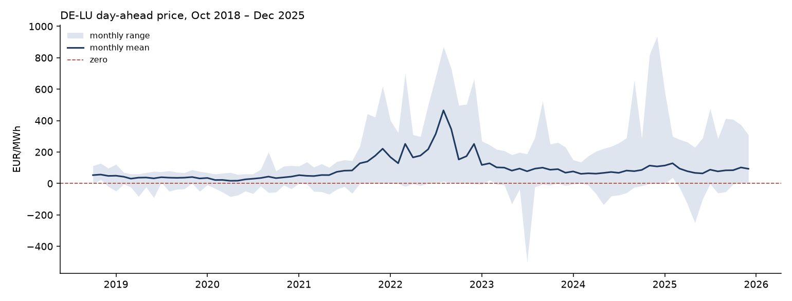
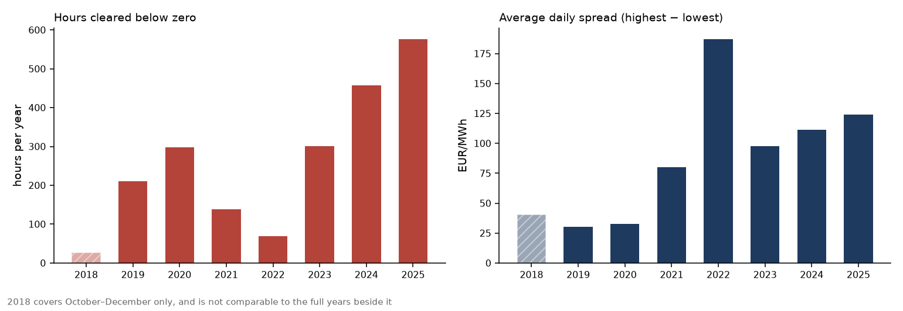
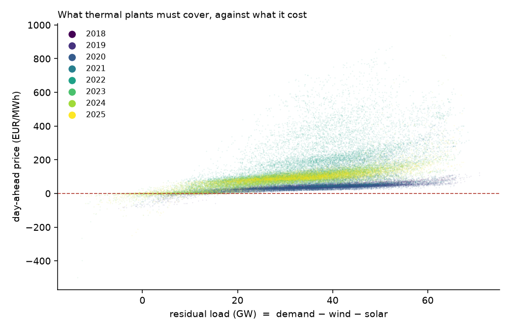

# Battery Storage Backtest

Forecasting German day-ahead electricity prices, and measuring what the forecast is
actually worth to a battery.

[In short](#in-short) · [How it works](#how-it-works) · [Stages](#where-this-is-going) ·
[The market](#what-the-market-actually-did) · [Running it](#running-it) ·
[Full record](docs/decisions.md)

## In short

**The question.** A battery must commit tomorrow's charging plan by noon today, before tomorrow's
prices are known. How much of the possible money does a price forecast actually earn?

**The answer: 90.1 %** of what the battery could have earned if tomorrow's prices had been known.
Tested on 2024–25, two years kept aside until the end and checked once.

| 1 MW / 2 MWh battery, per year | Earned | Share of the best possible |
|---|---|---|
| Best possible: tomorrow's prices known in advance | 67,000 € | 100 % |
| Average of three forecasts, plan sent as is | 63,300 € | 94.4 % |
| Main forecast, plan sent as is | 62,300 € | 93.0 % |
| **Main forecast, plan sent with price limits** | **60,400 €** | **90.1 %** |
| No forecast: assume tomorrow repeats yesterday | 56,900 € | 84.9 % |

The main forecast is the field's standard method (*LEAR*): one linear model for each hour of the
day. It squashes price spikes so a few extreme hours can't steer it, and drops the inputs that don't
help (*LASSO*).

### What held

- **Forecasting pays: about 5,400 € a year** more than assuming tomorrow repeats yesterday. It earned
  more on 501 days and less on 211, far too many to be luck (p < 10⁻²⁵).
- **Averaging three forecasts pays about 1,000 € more.** Found on 2023, then confirmed on 2024–25
  (p 0.0001).
- **No hindsight.** Every input was public before the auction closed. Code enforces this, and tests
  were shown to catch leaks planted on purpose. Nothing was tuned after looking at the test years.

### What did not

- **The winner on the practice year lost the final test.** A tree-based model (*gradient boosting*)
  beat a plain linear model on 2023 and lost to it on 2024–25. Since then, every comparison must pass
  a significance test.
- **Smaller error did not mean more money.** The plain linear model, clearly worst by error, earned
  about as much as the best. A battery is paid for knowing *which hours* are cheap and dear, not how
  high prices are overall. This was tested directly.
- **Price limits cost money.** They stop losing trades, but good ones too. Sending the plan without
  limits earned 93.0 %, against 90.1 % with them.

### Limits

- **One market only: the day-ahead auction.** Across all markets, German batteries earned two to three
  times our best case in 2024, mostly from grid reserve.
- **One exchange rule is guessed.** Nobody has confirmed whether the exchange checks each order of a
  buy-and-sell pair alone or the pair together. Together gives 94.0 %, and we report the cautious 90.1 %.
- **Hourly prices.** The market moved to 15-minute prices in October 2025.
- **Simplified money.** A small battery that doesn't move prices. Earnings are before fees, with wear
  charged at 8 € per MWh.
- **Two test years.** Enough to rank the average above the main forecast, not to rank the single models
  against each other.

### Reproduce it

Python 3.11 and a free ENTSO-E account, which provides the data token. Step-by-step setup is under
[Running it](#running-it).

```bash
python3 -m venv .venv && .venv/bin/pip install -r requirements.txt
.venv/bin/python -m pytest tests/ -q     # 298 tests, offline, ~2 min
just pull                                # the data, ~20 min
just final-score                         # forecasts for 2024–25, ~40 min
just final-score ranges                  # their price ranges, ~4.5 h
just final-score battery                 # the table above, under a minute
```

**The long runs are a one-off check, not what forecasting costs.** `just final-score` and
`just final-score ranges` replay two whole years, refitting every day, to regenerate the results.
Forecasting a single day should take about 20–25 seconds, worked out from measured parts; the daily
command is still to be built.

### Next steps

- **Run it every day.** It can't forecast tomorrow yet: there is no daily data pull and no "tomorrow"
  command. Decided: each morning it sends the average of the three forecasts, without price limits,
  because that earned the most on both readings; LEAR's plan if one model fails.
- **Rerun from scratch.** Regenerate these numbers from a fresh copy with freshly pulled data. ENTSO-E
  revises old data, so small differences are possible.
- **Watch for drift.** Flag when forecasts or ranges start missing more than usual.
- **A web page.** Pick a past day and see the forecast, the real price, the battery's plan and what it
  earned.

---

## How it works

A battery earns money by charging when power is cheap and discharging when it is dear. In
Germany's day-ahead auction it must commit its plan by noon the day before, while tomorrow's prices
are still unknown. So there are two problems: forecast the prices, then decide what to do about them.

```
public data → forecast → battery plan → paid at real prices → share of the best possible
(published before noon)    (the decision)       (what actually happened)
```

Every result is reported three ways, so the number means something:

| Run | Plans on | Tells you |
|-----|----------|-----------|
| **Best possible** | the real prices, known in advance | the most the battery could have earned (*the ceiling*) |
| **Forecast** | our forecast | what this project earns |
| **No forecast** | tomorrow repeats yesterday | what no modelling earns (*the naive rule*) |

**Share of the best possible = forecast's earnings ÷ ceiling** (*capture rate*). It answers the
question this project is built around: how much of the possible money does a forecast capture, and
when does a better forecast stop being worth more?

**Why the battery, and not just the forecast.** Price forecasts are close to a commodity: several
firms sell them, and their accuracy differs little. The value sits on either side of the forecast:
turning it into a plan the battery can actually run, and having that plan ready at 11:45 every
morning. A project that stopped at a good forecast error would have measured the least valuable part.

## Where this is going

Six stages. Each one ends on a number, and no stage starts before the last number exists. So every
claim traces back to the run that produced it.

| Stage | What it adds | Ends on | Status |
|---|---|---|---|
| 0 | The data, pulled the same way every time; the years split | negative-price hours, daily spread | **done** 17 Sep 2026 |
| 1 | A first forecast, against the simple rule | error 0.532 *(rMAE, last week's rule)* | **done** 30 Sep 2026 |
| 2 | Retraining every day; LEAR; public holidays | **error 0.485** *(rMAE)* | **done** 14 Oct 2026 |
| 3 | A price range around each forecast | **pinball 4.655** | **done** 19 Oct 2026 |
| 4 | The battery: a plan, bids with price limits, earnings | **90.1 % of the best possible** | **done** 27 Oct 2026 |
| 5 | A daily run, drift checks, a web page | reproducibility | next |

**How forecast error is scored.** Our average miss divided by a simple rule's average miss (*rMAE*):
below 1 beats the rule. Until 15 October the rule was "same hour last week". Since then it is the
field's rule: "same hour yesterday" from Tuesday to Friday, last week from Saturday to Monday. That
rule is harder to beat, so the same forecast scores higher. Older numbers keep their old rule, and
say so. Rankings and p-values do not change.

**The full record** — every decision, the alternatives it rejected, and each stage's detailed
results — is in [docs/decisions.md](docs/decisions.md).

### What each stage found

**Stage 0: the data.** Seven years of German day-ahead prices and the public forecasts published
alongside them, from October 2018, when the German–Luxembourg price zone began. A pull never
overwrites what it saved before, because ENTSO-E revises old data. A check proves each forecast
series really is a forecast, not the real outcome under another name. What the market did is under
[What the market actually did](#what-the-market-actually-did).

**Stage 1: the practice-year winner lost the real test.** A tree-based model (*gradient boosting*)
beat a plain linear model on 2023, 0.488 against 0.532 (last week's rule). On 2024–25, same recipe, it lost: 0.627
against 0.575. It had been picked partly because it suited 2023. Since then, every comparison must
pass a significance test (*Diebold-Mariano*) before it is believed.

**Stage 2: retraining every day was the biggest gain.** Retraining as the year runs, rather than once,
improved the tree more than any choice of model: 0.483 → 0.429 on 2023 (last week's rule). Then LEAR, the field's
standard method: one linear model per hour of the day, price spikes squashed so a few extreme hours
can't steer it, and unhelpful inputs dropped (*LASSO*). On 2024–25 it misses by 13.28 €/MWh on
average, against 27.38 for the field's simple rule: **error 0.485**. It beat the tree (0.548) and the
plain linear model (0.648), both clearly (p < 0.0001). Public holidays changed nothing: the published
load forecast already drops on holidays. **A limit:** this is a good standard result, not a top one;
the field's best combined forecasts reach about 0.37 on other years.

**Stage 3: a price range around each forecast.** A battery that sends price limits ("buy only below
60 €") needs to know how far the forecast may be off. Two ways to get that range: learn how LEAR's
misses depend on its forecast (*Quantile Regression Averaging, QRA*), or draw a band as wide as its
recent misses (*conformal prediction*). Each uses four look-back windows (28 to 182 days), averaged.
QRA was better on 2023 and again on 2024–25 (*pinball loss* 4.655 against 4.983, lower is better;
p < 0.0001). **A limit:** the ranges run a little narrow in the dearest months: the 80 % band held
about 70–75 % of hours in November–December 2024.

**Stage 4: what the forecast is worth.** The numbers are in [In short](#in-short). How the battery is
planned, each choice checked against the field and the exchange's rules:

- **One day at a time, starting and ending empty.** At noon nobody has a forecast for the day after
  tomorrow, and charge held overnight would need two auctions.
- **Each buy and its sell go as one package**, filled whole or not at all (the exchange's *loop
  blocks*).
- **Price limits set from the range**, moved until a trade would just break even, so no filled trade
  can lose money.
- **The cautious reading of the exchange's rules leads**: each order of a pair must beat its own
  limit. The other reading is reported beside it.

What it found, beyond the headline:
- **Money does not rank models the way error does.** The plain linear model, worst by error, earned
  about as much as LEAR. Tested directly: knowing each day's true *shape* takes every model to
  99.5–99.8 %; knowing its true *level* adds nothing.
- **Averaging the three forecasts pays**, found on 2023 and confirmed on 2024–25.
- **Price limits cost more than they save** under the cautious rule: they turned away about 5,200 € of
  good trades to avoid about 1,400 € of losses over two years.
- **Compared with published German figures**, the day-ahead auction is only a slice of what a battery
  earns: across all markets, 2024 figures run two to three times our best case, mostly from grid
  reserve. No published figure plans on a forecast, so the 90.1 % has no outside counterpart.
- **One alarm, explained.** Two runs beat the best possible on one day each, by about a cent. That is
  the solver's tolerance; solved exactly, the best possible is never beaten.

**Stage 5, decided so far.** The daily run will send the average of the three forecasts, without
limits, with LEAR's plan as the fallback. The headline stays the 90.1 % fixed before the reading.

**Reproduce** stage 4 with `just final-score battery`; the 2023 runs with `just backtest ceiling`,
`fixed` and `bids`; every p-value with `just significance`.

### The plan as a page

The same plan as a shareable page, refreshed at every milestone:
<https://claude.ai/artifact/Mysse8XGB4exGFykeDcmYm>. This README is the reference; the page is the
version that travels. An older version, as it stood until 2 October, is kept unchanged as a dated
snapshot. [docs/worklog.md](docs/worklog.md) records both links.

### Roughly when

Stages 2 to 4 each closed in the week estimated or earlier. Stage 4 closed on 27 October. On 30
October the euros were compared with published figures and this README was rewritten in plain
words. Stage 5 is next.

| Stage | Estimate | Ends around |
|---|---|---|
| 2 | done | 14 October 2026 |
| 3 | done | 19 October 2026 |
| 4 | done | 27 October 2026 |
| 4½ | revenue check, summary, README: done 30 Oct | — |
| 5 | ~1½ weeks | week of 9 November 2026 |

## Market, split and battery

| | |
|---|---|
| Market | Day-ahead auction, DE-LU bidding zone |
| Target | Hourly clearing price, €/MWh |
| Decision point | 12:00 the day before delivery, when the auction closes |
| Horizon | 12–36 hours |
| Train / validate / test | Oct 2018 – 2022 / 2023 / 2024–2025 |
| Battery | 1 MW, 2 MWh, 90 % efficient each way (81 % round trip), wear charged at 8 € per MWh sold |

The history starts in October 2018, when the German–Luxembourg price zone (*DE-LU*) began. Before
that, Germany, Austria and Luxembourg shared one zone and one price: a different market.

## What the market actually did

Seven years of DE-LU day-ahead prices, 63,577 hours. Regenerate every figure below with
`just explore`.



The average went up and came back. The variation went up and stayed — the shaded band never
returns to its 2019 width. **A battery is paid for the band, not the line.**

Two numbers put a figure on the band.



| Year | Hours below zero | Share | Deepest | Mean daily spread | Days not worth cycling² |
|---|---|---|---|---|---|
| 2018¹ | 27 | 1.2 % | −19 | 40.6 | 2 |
| 2019 | 211 | 2.4 % | −90 | 30.1 | **26** |
| 2020 | 298 | 3.4 % | −84 | 32.5 | 12 |
| 2021 | 139 | 1.6 % | −69 | 80.3 | 2 |
| 2022 | 69 | 0.8 % | −19 | **187.0** | 1 |
| 2023 | 301 | 3.4 % | **−500** | 97.9 | **0** |
| 2024 | 457 | 5.2 % | −135 | 111.2 | **0** |
| 2025 | **576** | **6.6 %** | −250 | 124.1 | 1 |

¹ October to December only.
² Days where the best hour did not beat the cheapest hour by enough to cover round-trip
losses and wear — so the right answer was to stay idle, even knowing the prices in advance.

**Negative hours have risen more than twentyfold** — from 27 in the zone's first quarter to
576 in 2025, when one hour in fifteen cleared below zero. One hour in 2023 reached the
−500 €/MWh floor, the lowest the auction permits.

**The daily spread has roughly quadrupled**, from about 30 €/MWh to about 124. Since a
battery is paid for the spread and nothing else, that is the headline: the opportunity this
project measures is several times larger than it was in 2019.

**The two columns are not the same story twice.** 2025 has more negative hours than 2022
(576 against 69) but a smaller spread (124 against 187). So what produced the spread changed:
in 2022 the expensive hours were extremely expensive; in 2025 the cheap hours are extremely
cheap. **The second kind is worth more**, and the reason is the round-trip loss changing sign.

To deliver 1 MWh, a battery must buy 1 ÷ 0.81 = 1.235 MWh — so the charging price is always
multiplied by 1.235. Against a positive price that works against you; against a negative price
it works for you. Three days with an identical headline spread of 100 €/MWh:

| Charge at | Discharge at | Earned per MWh delivered |
|---|---|---|
| 100 | 200 | 68.5 |
| 0 | 100 | 92.0 |
| −50 | 50 | **103.7** |

Same spread, and half as much again from the third day as the first. A negative hour is worth
more than its face value; an expensive hour has to overcome the loss rather than profit by it.

2021–22 interrupts both columns, and that interruption sits in the middle of the training
period. What caused it is not visible in this data — these files hold prices, load and
weather forecasts, and no fuel or carbon prices at all. The interruption is treated here as
something the model has to survive, not something this repository can explain.

**The last column narrows the question this project has to answer.** In 2019 there were 26
days when a battery with perfect foresight should have stayed idle. Across 2023–2025 there
was one. So *whether* to trade is no longer a real decision — it is always yes. What is left
is **which hours, and how many cycles**, and that is a harder question than the one it
replaced.

### Why the price is what it is

The strongest single driver is **residual load** — demand minus wind and solar, built only
from forecasts published before the auction closed. It is what has to be covered by something other
than the weather.

Fitting a straight line through each year separately gives two numbers. The slope says how
many €/MWh one GW of residual load is worth. The correlation says how tightly the two move
together.

| Year | Slope (€/MWh per GW) | Correlation | Hours |
|---|---|---|---|
| 2018¹ | 1.28 | 0.910 | 1,367 |
| 2019 | **1.12** | 0.848 | 8,760 |
| 2020 | 1.16 | 0.828 | 8,784 |
| 2021 | 3.53 | **0.583** | 8,760 |
| 2022 | **7.10** | 0.623 | 8,712 |
| 2023 | 3.09 | 0.883 | 8,759 |
| 2024 | 2.99 | 0.775 | 8,783 |
| 2025 | 3.12 | 0.871 | 8,759 |
| **Pooled** | — | **0.440** | 62,684 |

¹ October to December only.

**The pooled correlation is the weakest number in the table, and that is the finding.** Each
year on its own holds together far better than all of them together. So this is several
relationships stacked, not one relationship scattered — and a model fitted across the whole
record is averaging markets that behaved differently.



**The slope roughly tripled and stayed tripled** — about 1.1 before 2021, about 3.1 since 2023.
The eight lines sort into three groups, not eight variations on one market: flat and tight
(2018–20), steep and badly fitting (2021–22), steep and tight again (2023–25).

**What that costs is a transfer problem, not an input problem.** It is not that a wrong
weather forecast now costs more — bids were placed against the *published* forecast, so a
forecast that turns out wrong is settled in the balancing markets, not in this auction. The
cost lands on a model that learned the wrong relationship:

| Fitted on | Asked about an ordinary 40 GW day | |
|---|---|---|
| 2019–20 | says **39 €/MWh** | |
| 2024–25 | answer is **114 €/MWh** | **74 €/MWh of error, before any noise** |

**2021 and 2022 are the two years that fit badly** (0.58 and 0.62), and 2022 is also the
steepest by a distance. In those years something other than residual load was doing much of
the work, and **this dataset cannot say what** — it holds no fuel or carbon prices. Whether to
add them is an open scope question, held until the model shows whether it needs them.

Both awkward years sit inside the training period. The test years fit well and share a slope.
That is the problem the models have to survive. Stage 1's model had no correction for it, on
purpose, so later stages had something to beat. What helped most was retraining every day.

### What negative prices are not

Negative prices are usually explained as wind and solar making more than the country needed.
Mostly they are not:

| Of 2,053 hours that cleared below zero | |
|---|---|
| Wind and solar alone exceeded demand | 424 (**21 %**) |
| Median residual load during those hours | **+5.1 GW** |

Four fifths of the time the system still needed several GW from something else, and the price
went below zero anyway. Something kept generating that would have lost more by stopping
(*must-run generation*).

Naming the cause is beyond this dataset. Counting the hours is not, and the count is enough to
rule out the simple explanation.

## Ground rules

- **Use only what was public before the auction closed.** The grid operators' published forecasts
  qualify. What actually happened does not, however easy it is to download today.
- **Check the test years once per stage.** Checking again after changing something makes the final
  number look better than it is.
- **Every model faces a benchmark**: first the simple rule, then LEAR from the
  [epftoolbox](https://github.com/jeslago/epftoolbox). A significance test (*Diebold-Mariano*) decides
  whether a gap is real.

## Data

| Source | Used for |
|--------|----------|
| [ENTSO-E Transparency Platform](https://transparency.entsoe.eu) | Prices, load forecast, wind and solar generation forecast, actual generation |
| [SMARD.de](https://www.smard.de) | Cross-check, and a fallback while API access is pending |

ENTSO-E API access requires a free account plus a token request. No raw data is committed
to this repository — the pull is reproducible from `src/data.py`.

[docs/data-quality.md](docs/data-quality.md) records what the history actually contains:
coverage per series, the gaps and what was decided about them, and seven hours the client
library silently dropped before anyone counted.

## Running it

**Prerequisite: Python 3.11.** Nothing else. The exact version is pinned in
`.python-version`; anything 3.11.x will do.

### Get it running — three commands, no extra tooling

```bash
git clone <this repo> && cd battery-storage-backtest

python3 -m venv .venv                              # a project-local environment
.venv/bin/pip install -r requirements.txt          # once, not per terminal session
.venv/bin/python -m pytest tests/ -q               # 298 tests, offline, no token
```

That's the whole setup. `pip install` writes into `.venv/` on disk, so it persists — you
never repeat it unless `requirements.txt` changes, and you never need to "activate"
anything, because every command below names the interpreter explicitly.

Expect `298 passed`, in about two minutes. The commands that regenerate each result are under
[Reproduce it](#reproduce-it).

### See it work, without a token

```bash
.venv/bin/python -m scripts.explore     # headline numbers and the three figures
```

Needs the cached data — see the next section. Everything above this line runs on a fresh
clone with no account anywhere.

### With an ENTSO-E account

The platform is free; registration takes a day or two because the API token is granted by
hand. Then:

```bash
cp .env.example .env                                 # paste your token into it
.venv/bin/python -m scripts.verify_forecast_series   # ~20 s — are the forecasts forecasts?
.venv/bin/python -m scripts.pull                     # ~20 min, ~34 MB
.venv/bin/python -m scripts.explore                  # now has data to describe
```

### Shorter commands, optional

Those `.venv/bin/python -m ...` invocations are what the [`justfile`](justfile) wraps. If you
install [`just`](https://just.systems), each becomes one word:

```bash
brew install just                  # macOS
pip install rust-just              # any platform, ships the same binary
# or: curl -sSf https://just.systems/install.sh | bash -s -- --to ~/.local/bin

just                               # the menu
just setup · test · pull · verify · explore · train · quantiles · significance · final-score · clean
```

**Nothing requires it.** The justfile is the single source of truth for what each command is,
so it doubles as documentation — read it and you have the raw commands, which is why they are
not duplicated here to drift out of step. `just` also searches parent directories, so its
recipes work from anywhere in the project, and the same commands appear in VS Code under
*Tasks: Run Task*.

### Why the pull is safe to re-run

It fetches the whole history every time and **never overwrites what is already cached.** Run
it twice and every series reports `unchanged` — that is the reproducibility check made
observable, and it is why a revision on ENTSO-E's side cannot rewrite the data a published
result rested on. Displaced copies are kept under `data/raw/archive/`, and every pull appends
a line to `data/raw/manifest.csv`.

Dependencies are pinned exactly in `requirements.txt`, hand-curated rather than frozen, so a
clean clone resolves to the same versions that produced every number above.

## Structure

[docs/architecture.md](docs/architecture.md) is the map — what each file is for, how they
connect, and where to start reading. In short:

```
BUILT
  src/config.py              split dates, EIC codes, battery parameters — single source of truth
  src/sources/entsoe.py      the data-item catalog: what is fetched, and what may reach a model
  src/data.py                caching and normalisation; the loaders everything else calls
  src/features.py            the gate — where the availability rule is enforced, not declared
  src/models.py              the benchmarks, the linear model, the tree, LEAR, and the price ranges
  src/evaluate.py            rMAE, pinball and coverage, Diebold-Mariano, all on shared hours
  src/backtest.py            the battery's plan (an optimiser, MILP), day by day, paid at real prices
  scripts/pull.py            just pull        — fetch every series in the catalog
  scripts/explore.py         just explore     — headline numbers and the README figures
  scripts/train.py           just train       — score the validation year, as often as you like
  scripts/quantiles.py       just quantiles   — QRA and conformal ranges around LEAR, scored on 2023
  scripts/final_score.py     just final-score — read the held-back years, once per stage (`ranges`: stage 3; `battery`: stage 4)
  scripts/significance.py    just significance — every p-value the README states, from MLflow
  scripts/backtest.py        just backtest    — the battery on 2023 (`ceiling`, `fixed`, `bids`)
  reports/scores.csv         every scored run, appended, stamped with its commit
  reports/quantile_scores.csv the same for ranges: pinball, coverage, crossing, window
  reports/capture_scores.csv the same for the battery: earnings and share of the ceiling, 2024-25
```

Everything above `features.py` is transport: getting data from ENTSO-E onto disk without
damaging it. Everything below it is a decision. The two scripts at the bottom are split for the
same reason: `train.py` has no code path to the held-back years, and a test enforces it, so
the one reading a stage is allowed stays something you have to mean to do. That file is where the question changes from
*"did we fetch this correctly?"* to *"were we allowed to know this?"* — which is why it carries
two independent guards and a test that rebuilds a delivery day from a world truncated at the
auction deadline.

## Scope

**In:** day-ahead prices, Germany, hourly resolution, one battery, one revenue stream.

**Out:** intraday trading, balancing reserve, multiple countries, quarter-hourly modelling.
Each is interesting; each is a separate project.

**Also out, and worth naming because the distance is the point.** None of the following is
built here, and a backtest is not a system without them:

| What production adds | Why it matters |
|---|---|
| A hard deadline | the forecast exists before 12:00, every day. In practice an internal cut-off an hour earlier, leaving room to run the optimiser, submit and recover — which is an operational margin, not the information boundary the backtest is judged against. Usually ready is unusable |
| Fallbacks | when a source is late, something still has to be bid. On 9 September the ENTSO-E API was unreachable for over an hour, and only a second source kept work moving |
| Alerts, not dashboards | a message when coverage or error crosses a threshold, rather than a chart nobody is watching at 11:45 |
| Backfill and versioning | when history is revised, yesterday's decisions stay explainable |
| A named person awake at 11:45 | the part no amount of modelling replaces |

## Honest framing

Day-ahead price forecasting is not a novel research problem. Every direct marketer and
storage optimiser runs a better version of this, with more data and full-time teams. The
purpose here is a well-built, honestly evaluated implementation — not a new result.

The revenue figures are gross trading margin from day-ahead arbitrage: one revenue stream,
before grid fees, taxes and capital costs. They are not an investment case. Published figures for
2024 put a German two-hour battery's income across all markets at two to three times this project's
perfect-foresight ceiling, most of it from reserve ([docs/decisions.md](docs/decisions.md), *Where stage
4 landed*).

And one thing worth keeping in view while building, because it decides what the final number
means. **Accuracy only pays where it changes a decision.** If two forecasts produce the same
battery schedule, the more accurate one earned nothing. So the interesting result at the end
is not the error metric — it is the point where better forecasts stop converting into money.

Stage 1 showed the first half of that. The tree beat the plain linear model on the practice year
and lost to it on years nothing had been tuned against: a difference in error that looked real was
not. Stage 4 found the second half. The plain linear model, worst by error, earned about as much as
LEAR, because the battery is paid for the day's shape, not its level.

## References

Listed with the claim each one supports, so a reader can check the reasoning rather than
take it on trust. Where this repository states a number, the number comes from a command in
[Running it](#running-it) — these are for the choices around it.

**Method**

| Source | What it supports here |
|---|---|
| Lago, Marcjasz, De Schutter & Weron (2021), *Forecasting day-ahead electricity prices: a review of state-of-the-art algorithms, best practices and an open-access benchmark*, Applied Energy 293 — [ScienceDirect](https://www.sciencedirect.com/science/article/pii/S0306261921004529) · [preprint (PDF)](https://www.dcsc.tudelft.nl/~bdeschutter/pub/rep/21_011.pdf) · doi:10.1016/j.apenergy.2021.116983 | Why LEAR is the benchmark to beat rather than an arbitrary choice, and why the field's default calibration window is a rolling two years rather than all available history |
| [epftoolbox](https://github.com/jeslago/epftoolbox) | The reference implementation of LEAR and DNN that accompanies the paper above |
| Diebold & Mariano (1995), *Comparing Predictive Accuracy* — [paper](https://www.semanticscholar.org/paper/Comparing-Predictive-Accuracy-Diebold-Mariano/1b2e489a0ea4a937b64df59f42509fb043765cbb) | Why a lower average error is not by itself evidence that one forecast beats another: errors run in streaks and move together, so the spread has to be estimated robustly |
| Diebold (2015), *Comparing Predictive Accuracy, Twenty Years Later* — [NBER w18391 (PDF)](https://www.nber.org/system/files/working_papers/w18391/w18391.pdf) | The author's own account of where the test is misapplied — worth reading before using it, not after |
| [Testing for equal predictive accuracy with strong dependence](https://arxiv.org/pdf/2409.12662) | That the test loses power as errors become more dependent, so "not significant" must be read as *cannot tell*, never as *the same* |

**Data**

| Source | What it supports here |
|---|---|
| [ENTSO-E Transparency Platform](https://transparency.entsoe.eu) | Every series in the pull. Terms of use are theirs, which is why no raw data is committed |
| [SMARD.de](https://www.smard.de) | The independent cross-check that confirmed prices to the cent, and the fallback that kept work moving through an API outage |
| [Energy-Charts](https://api.energy-charts.info) | The validated alternative for the 37 load-forecast days ENTSO-E is missing — evaluated in [docs/data-quality.md](docs/data-quality.md) and deliberately not yet adopted |

## Licence

Code is MIT licensed — see [LICENSE](LICENSE). This covers the code only; data retrieved
from ENTSO-E remains subject to their own terms of use.
